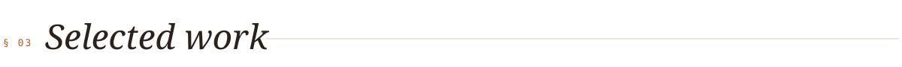
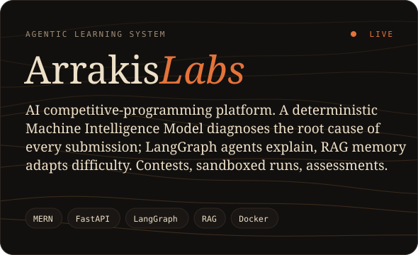
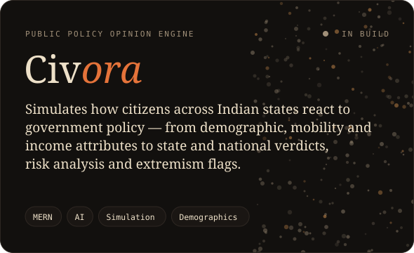
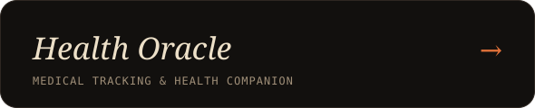
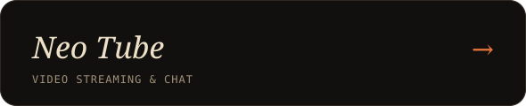
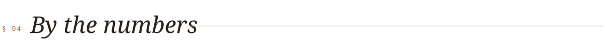

  <a href="https://www.linkedin.com/in/akash-singh1312"><b>LinkedIn</b></a> &nbsp;·&nbsp;
  <a href="mailto:akash.ece.mnnit@gmail.com"><b>Email</b></a>

  I turn messy, real-world problems into <b>systems that think</b> — agents that reason, interfaces people enjoy, backends that hold under load. 
  <i>Curious by default, full-stack by obsession,</i> currently teaching software to diagnose itself. 
  Open to <b>internships</b>, <b>freelance builds</b> and anything that needs to ship.

 

<picture>
  <source media="(prefers-color-scheme: dark)" srcset="assets/now.svg"/>
  
</picture>

 

<picture>
  <source media="(prefers-color-scheme: dark)" srcset="assets/stack.svg"/>
  
</picture>

<picture>
  <source media="(prefers-color-scheme: dark)" srcset="assets/h-work.svg"/>
  
</picture>

  
  
  
  

<picture>
  <source media="(prefers-color-scheme: dark)" srcset="assets/h-numbers.svg"/>
  
</picture>

  
  

 

  <a href="https://www.linkedin.com/in/akash-singh1312"><picture><source media="(prefers-color-scheme: dark)" srcset="assets/social/linkedin-dark.svg"/></picture></a>&nbsp;
  <a href="mailto:akash.ece.mnnit@gmail.com"><picture><source media="(prefers-color-scheme: dark)" srcset="assets/social/gmail-dark.svg"/></picture></a>&nbsp;
  <a href="https://twitter.com/yourhandle"><picture><source media="(prefers-color-scheme: dark)" srcset="assets/social/twitter-dark.svg"/></picture></a>&nbsp;
  <a href="https://discord.gg/yourdiscord"><picture><source media="(prefers-color-scheme: dark)" srcset="assets/social/discord-dark.svg"/></picture></a>&nbsp;
  <a href="https://youtube.com/@yourchannel"><picture><source media="(prefers-color-scheme: dark)" srcset="assets/social/youtube-dark.svg"/></picture></a>

